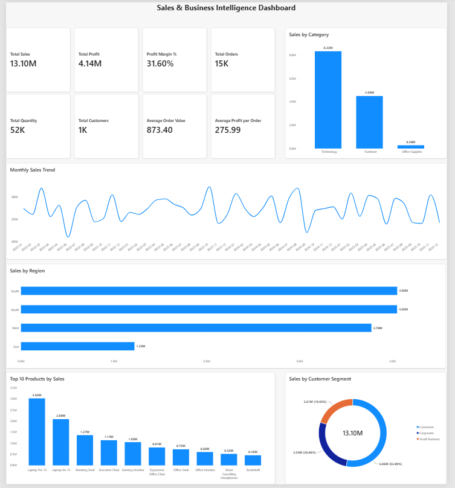
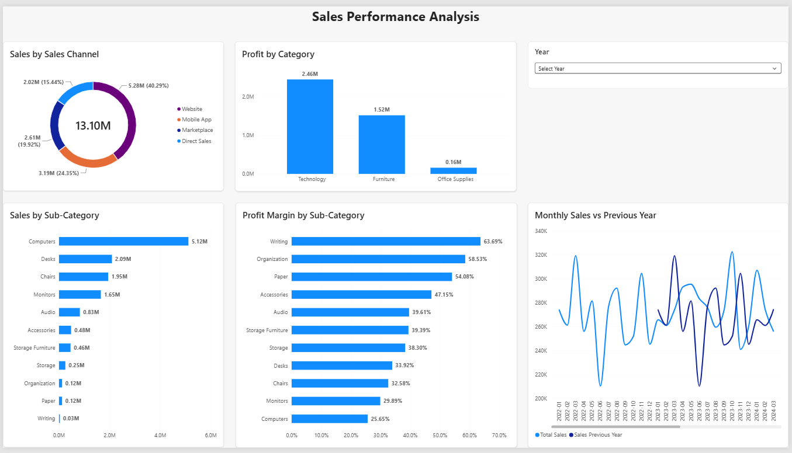
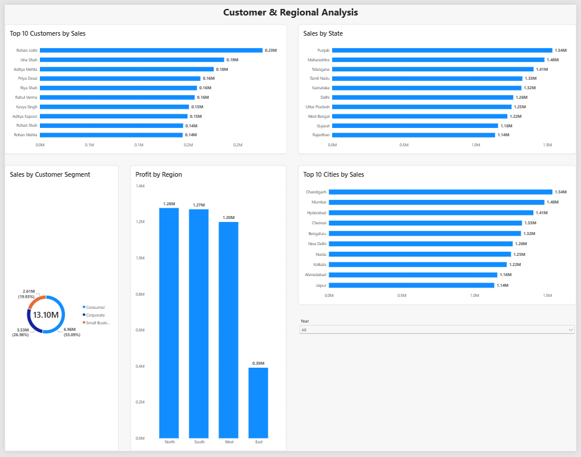

# Power BI Sales & Business Intelligence Dashboard

An end-to-end Power BI business intelligence project designed to analyze sales performance, profitability, customer behavior, product performance, and regional trends using a synthetic sales dataset.

The project demonstrates practical skills in **Power BI, Power Query, DAX, data modeling, data visualization, dashboard design, and business analysis**.

## Project Overview

This project analyzes **15,000 synthetic sales orders** covering the period from **2022 to 2025**. The dashboard transforms raw sales data into interactive business intelligence reports that help users understand overall performance, sales trends, profitability, customer segments, product performance, and regional results.

The Power BI report contains three interactive pages:

1. **Executive Overview**
2. **Sales Performance Analysis**
3. **Customer & Regional Analysis**

> **Note:** The dataset used in this project is synthetic and was created for educational and portfolio purposes. The results and business insights are illustrative and do not represent a real company.

## Key Features

- Interactive **3-page Power BI dashboard** for executive, sales, customer, and regional analysis.
- Built from **15,000 synthetic sales orders** spanning 2022–2025.
- Data cleaning and transformation performed using **Power Query**.
- Star-style data model using dedicated **Date, Customer, and Product dimension tables**.
- DAX measures for sales, profit, profit margin, order value, customer counts, and time-intelligence analysis.
- **Year-over-Year (YoY)** and **Year-to-Date (YTD)** measures for performance analysis.
- Interactive **Year slicers** for dynamic report filtering.
- Analysis by product category, sub-category, sales channel, customer segment, region, state, city, and customer.
- Comparison of **current sales with previous-year sales**.
- KPI cards for high-level business performance monitoring.

## Technology Stack

| Technology | Purpose |
|---|---|
| **Power BI Desktop** | Dashboard development and interactive reporting |
| **Power Query** | Data cleaning, transformation, and preparation |
| **DAX** | KPI calculations and time-intelligence measures |
| **Python** | Generation of the synthetic sales dataset |
| **CSV** | Source data storage |
| **Git & GitHub** | Version control and project portfolio hosting |
| **VS Code** | Project and documentation development |

## Data Model

The Power BI report uses a star-style data model with `sales_data` as the central fact table and three supporting dimension tables.

### Tables

- **sales_data** — Contains transaction-level sales information including orders, products, customers, sales, cost, profit, quantity, discounts, and sales channels.
- **DateTable** — Dedicated date dimension containing Date, Year, Month, Month Number, Month Short, Year Month, and Quarter.
- **DimCustomer** — Customer dimension containing customer ID, customer name, segment, country, region, state, and city.
- **DimProduct** — Product dimension containing product ID, product name, category, sub-category, and unit price.

### Relationships

- `DateTable[Date]` → `sales_data[Order Date]`
- `DimCustomer[Customer ID]` → `sales_data[Customer ID]`
- `DimProduct[Product ID]` → `sales_data[Product ID]`

All three relationships use a **one-to-many (1:*) relationship** from the dimension table to the sales fact table with single-direction filtering.

## DAX Measures

The dashboard uses DAX measures to calculate key business KPIs and perform time-intelligence analysis.

### Core KPI Measures

- **Total Sales** — Total revenue generated from sales.
- **Total Profit** — Total profit generated after costs.
- **Profit Margin %** — Profit as a percentage of total sales.
- **Total Orders** — Number of distinct orders.
- **Total Quantity** — Total number of units sold.
- **Total Customers** — Number of distinct customers.
- **Average Order Value** — Average sales value per order.
- **Average Profit per Order** — Average profit generated per order.

### Time-Intelligence Measures

- **Sales Previous Year** — Calculates sales for the corresponding period in the previous year.
- **YoY Sales Growth %** — Measures year-over-year sales growth.
- **YTD Sales** — Calculates cumulative sales from the beginning of the year to the current date.
- **YTD Profit** — Calculates cumulative profit from the beginning of the year to the current date.
- **Profit Previous Year** — Calculates profit for the corresponding period in the previous year.
- **YoY Profit Growth %** — Measures year-over-year profit growth.

## Dashboard Pages

### 1. Executive Overview

Provides a high-level view of overall business performance through key KPIs and summary visualizations.

Key visuals include:

- Total Sales, Total Profit, Profit Margin, Total Orders, Total Quantity, Total Customers, Average Order Value, and Average Profit per Order
- Monthly Sales Trend
- Sales by Category
- Sales by Region
- Top 10 Products by Sales
- Sales by Customer Segment



### 2. Sales Performance Analysis

Provides a deeper analysis of sales and profitability across products and sales channels.

Key visuals include:

- Sales by Sales Channel
- Sales by Sub-Category
- Profit by Category
- Profit Margin by Sub-Category
- Monthly Sales vs Previous Year
- Interactive Year filter



### 3. Customer & Regional Analysis

Analyzes customer performance and geographical sales and profitability.

Key visuals include:

- Top 10 Customers by Sales
- Sales by State
- Sales by Customer Segment
- Profit by Region
- Top 10 Cities by Sales
- Interactive Year filter



## Key Business Insights

Based on the synthetic dataset used in this project:

- Total sales reached approximately **13.10M**, generating approximately **4.14M in profit**.
- Overall **profit margin was 31.60%**.
- The dataset contains **15,000 orders** from **1,000 customers**, with approximately **52K units sold**.
- **Technology** was the highest-performing product category by sales, generating approximately **8.33M**.
- **Computers** was the leading sub-category, generating approximately **5.12M in sales**.
- **Website** was the largest sales channel, contributing approximately **5.28M (40.29%)** of total sales.
- The **Consumer** segment was the largest customer segment, contributing approximately **6.96M (53.09%)** of total sales.
- **South and North** were the strongest regions by sales, each generating approximately **4.05M**.
- **North** generated the highest regional profit at approximately **1.28M**, closely followed by South at approximately **1.27M**.
- **Writing** had the highest sub-category profit margin at approximately **63.69%**.
- **Rohan Joshi** was the highest-sales customer in the dataset at approximately **0.23M**.
- **Chandigarh** was the highest-sales city at approximately **1.54M**.

> These findings are based entirely on synthetic data and are intended to demonstrate business intelligence and analytical skills rather than represent real-world company performance.

## Project Structure

```text
power_bi_sales_analytics/
│
├── dashboard/
│   └── sales_analytics_dashboard.pbix
│
├── data/
│   └── sales_data.csv
│
├── reports/
│
├── screenshots/
│   ├── executive_overview.png
│   ├── sales_analysis.png
│   └── customer_regional_analysis.png
│
├── generate_dataset.py
└── README.md

## How to Use This Project

1. Clone or download this repository.
2. Open the project folder on your computer.
3. Open `dashboard/sales_analytics_dashboard.pbix` using Power BI Desktop.
4. Explore the three dashboard pages and use the available Year slicers to interact with the report.
5. The source dataset is available in `data/sales_data.csv`.
6. The synthetic dataset can be regenerated using `generate_dataset.py`.

### Requirements

- Power BI Desktop
- Python 3.x (only required if regenerating the synthetic dataset)

## Skills Demonstrated

This project demonstrates practical experience with:

- Power BI dashboard development
- Power Query data preparation
- DAX measures and calculations
- Time-intelligence analysis
- Data modeling and relationships
- KPI development
- Sales and profitability analysis
- Customer and regional analysis
- Interactive dashboard design
- Business insight generation
- Python-based synthetic data generation
- Git and GitHub project documentation

## Disclaimer

This project was developed for **educational and portfolio purposes**. The dataset is synthetically generated and does not contain real customer or company data. All results, trends, and business insights shown in the dashboard are illustrative.

## Author

**Abhi Patel**

MSc Data Science Graduate | Data Analyst | Junior Data Scientist